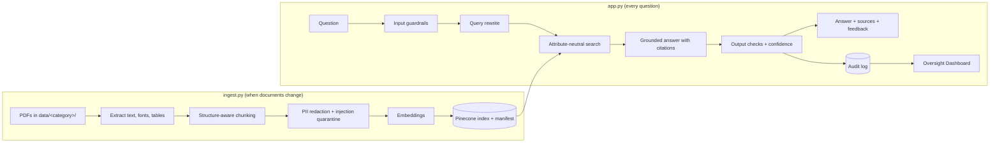

# Company Policy Assistant (RAG)

A chatbot that answers questions about company policies from your own PDF documents, with
citations, and with responsible-AI safeguards built in.

- **Many PDFs, any layout.** Employee, HR, finance, vendor, client, sub-contractor and
  infrastructure policies. Drop PDFs into category folders; the chunker adapts to each document's
  structure.
- **Grounded answers.** Every fact is cited to a document, section and page. The bot says "I couldn't
  find this" instead of guessing.
- **Responsible AI.** Fairness, transparency, accountability, privacy, safety, security, reliability
  and human oversight are implemented in code, configuration and process. See
  [docs/RESPONSIBLE_AI.md](docs/RESPONSIBLE_AI.md).



## Project structure

```
├── app.py                         Streamlit chat app
├── pages/1_Oversight_Dashboard.py Human review of flagged conversations (admin)
├── ingest.py                      Load / update / remove PDFs in the index
├── rag/
│   ├── pdf_extract.py             PDF -> lines with font size/bold + tables
│   ├── chunking.py                Structure-aware chunking for varied layouts
│   ├── ingestion.py               Categories, PII redaction, quarantine, metadata
│   ├── embeddings.py              Embedding model wrapper
│   ├── vectorstore.py             Pinecone store (+ in-memory store for tests)
│   ├── guardrails.py              PII, injection, safety, fairness, answer checks
│   ├── prompts.py                 All prompts, versioned
│   ├── llm.py                     Groq client, query rewrite, safety classifier
│   ├── pipeline.py                The question-answering pipeline
│   ├── audit.py                   Audit log, feedback, reviews
│   └── config.py                  Settings from environment / .env
├── eval/                          Retrieval and fairness evaluations
├── tests/                         Unit + end-to-end tests (no API keys needed)
├── docs/RESPONSIBLE_AI.md         Controls, procedures, limitations
├── data/                          Your PDFs (git-ignored)
└── .env.example                   Configuration template
```

## Setup (local)

You need Python 3.10+, a [Groq](https://console.groq.com) API key and a
[Pinecone](https://app.pinecone.io) API key (free tiers work).

```bash
git clone <your-repo-url> && cd <repo-folder>
python3 -m venv .venv
source .venv/bin/activate          # Windows: .venv\Scripts\activate
pip install -r requirements.txt
cp .env.example .env               # then add your GROQ_API_KEY and PINECONE_API_KEY
```

### 1. Add your policy PDFs

```
data/
├── employee_policies/handbook.pdf
├── vendor_policies/vendor_onboarding.pdf
├── finance_policies/expenses.pdf
└── ...
```

The folder name becomes the category (`hr_policies` → "HR Policies"). Users can filter by category in the app.

### 2. Check how the PDFs will be chunked (optional, recommended)

```bash
python ingest.py --dry-run
python ingest.py --dry-run --show-chunks
```

Each document gets a report showing the title, pages, chunks, headings found, tables, and warnings for
scanned pages or quarantined passages.

### 3. Load them into Pinecone

```bash
python ingest.py
```

Re-run it whenever documents change: new and changed files are uploaded, and unchanged files are skipped.

| Command | What it does |
|---|---|
| `python ingest.py` | Add new/changed PDFs from `data/` |
| `python ingest.py --prune` | Also remove documents deleted from `data/` |
| `python ingest.py --recreate` | Delete the index and rebuild everything (needed after changing `EMBED_MODEL`) |
| `python ingest.py path/to/file.pdf --category "Client Policies"` | Add one PDF with an explicit category |
| `python ingest.py --remove data/vendor_policies/old.pdf` | Remove one document |
| `python ingest.py --list` | Show what's in the index |

### 4. Run the app

```bash
python -m streamlit run app.py
```

Open http://localhost:8501. Set `ADMIN_PASSWORD` in `.env` to enable the **Oversight Dashboard** page.

## Running in Google Colab

```python
!git clone <your-repo-url> rag
%cd rag
!pip -q install -r requirements.txt
```

```python
import os
from getpass import getpass
os.environ["GROQ_API_KEY"] = getpass("Groq key: ")
os.environ["PINECONE_API_KEY"] = getpass("Pinecone key: ")
```

Upload PDFs into `data/<category>/` (Files panel), then:

```python
!python ingest.py
```

Start the app and open a public link with Cloudflare:

```python
import subprocess, time, re, os
if not os.path.exists("cloudflared"):
    !wget -q https://github.com/cloudflare/cloudflared/releases/latest/download/cloudflared-linux-amd64 -O cloudflared && chmod +x cloudflared
subprocess.Popen(["streamlit", "run", "app.py", "--server.port", "8501", "--server.headless", "true"],
                 stdout=open("streamlit.log", "w"), stderr=subprocess.STDOUT)
subprocess.Popen(["./cloudflared", "tunnel", "--url", "http://127.0.0.1:8501", "--no-autoupdate"],
                 stdout=open("cf.log", "w"), stderr=subprocess.STDOUT)
for _ in range(30):
    time.sleep(1)
    m = re.search(r"https://[a-z0-9-]+\.trycloudflare\.com", open("cf.log").read())
    if m: print(m.group(0)); break
```

## How chunking adapts to different PDFs

| Layout | How headings are found |
|---|---|
| Headings in larger or bold fonts (most Word / Google Docs exports) | **Font mode:** heading levels come from font size and weight |
| Everything in one font | **Text mode:** `4.2 Title`, `Section 3`, `ARTICLE IV`, ALL-CAPS lines, short title lines |
| FAQs | `FAQ-12: ...`, `Q: ...` or a short line ending in `?` becomes its own chunk |
| Tables | Each row becomes a sentence: `Expense type: Hotel; Limit: $250; Approver: Manager.` |

Also removed: running headers/footers, page numbers, tables of contents and duplicate boilerplate.
Each chunk is prefixed with its location, e.g.
`[Employee Policies] Handbook > 4. Remote and Hybrid Work > Equipment: …`, so search understands its
context.

## Testing and evaluation

```bash
pip install -r requirements-dev.txt
python -m pytest -q                         # unit + end-to-end tests, no API keys needed
python -m eval.retrieval_eval               # retrieval hit rate + MIN_RELEVANCE calibration
python -m eval.fairness_eval                # counterfactual fairness check
```

To test at scale without real policies, generate 10 fictional 100-page GlobalOmTech policy PDFs (four different
layouts) into `data/<category>/`:

```bash
python tools/generate_globalomtech_policies.py
```

Edit `eval/questions.json` to add questions about your own documents, each with text the answer must
contain. Out-of-scope questions with `"expect": []` check that the bot abstains.

Results on the sample data (NovaTech handbook + vendor, finance and HR samples):
retrieval hit rate **14/14**, out-of-scope abstention **3/3**, fairness coverage **1.00**
(up from 0.83 without attribute-neutral search).

## Configuration

All settings live in `.env`; see [.env.example](.env.example) for the full list. The most important are:

| Setting | Default | Purpose |
|---|---|---|
| `EMBED_MODEL` | `BAAI/bge-small-en-v1.5` | Search model (changing it needs `ingest.py --recreate`) |
| `LLM_MODEL` | `openai/gpt-oss-20b` | Answer model on Groq |
| `MIN_RELEVANCE` | `0.55` | Below this the bot abstains instead of answering |
| `ENABLE_LLM_MODERATION` | `true` | Second-layer safety classifier |
| `APP_PASSWORD` / `ADMIN_PASSWORD` | empty | Access control for the app / oversight dashboard |
| `MAINTENANCE_MODE` | `false` | Kill switch |
| `LOG_RETENTION_DAYS` | `90` | Audit-log retention |

## Limitations

See [docs/RESPONSIBLE_AI.md § Known limitations](docs/RESPONSIBLE_AI.md#10-known-limitations). In short:
scanned PDFs need OCR first, pattern-based detectors aren't perfect, and production deployments
should add SSO and per-role document access.
